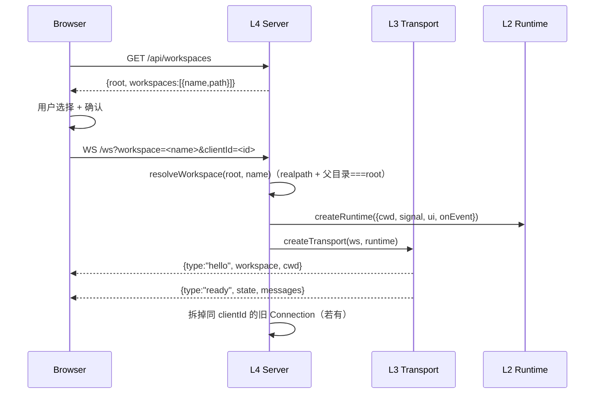
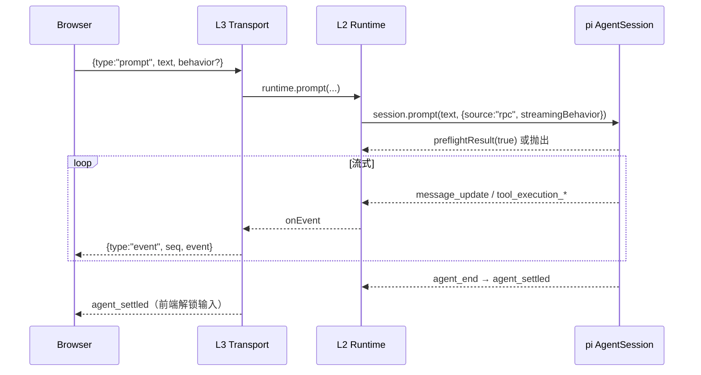
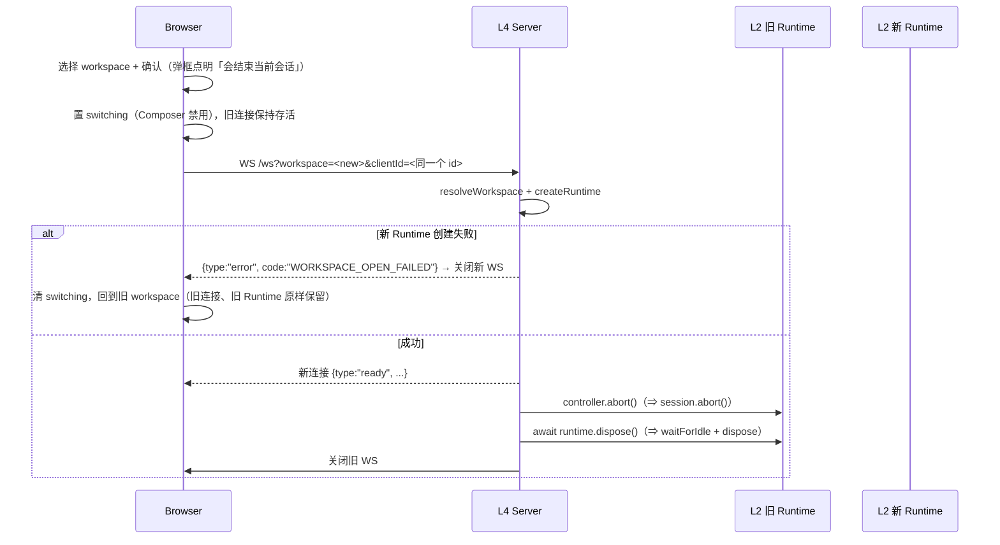
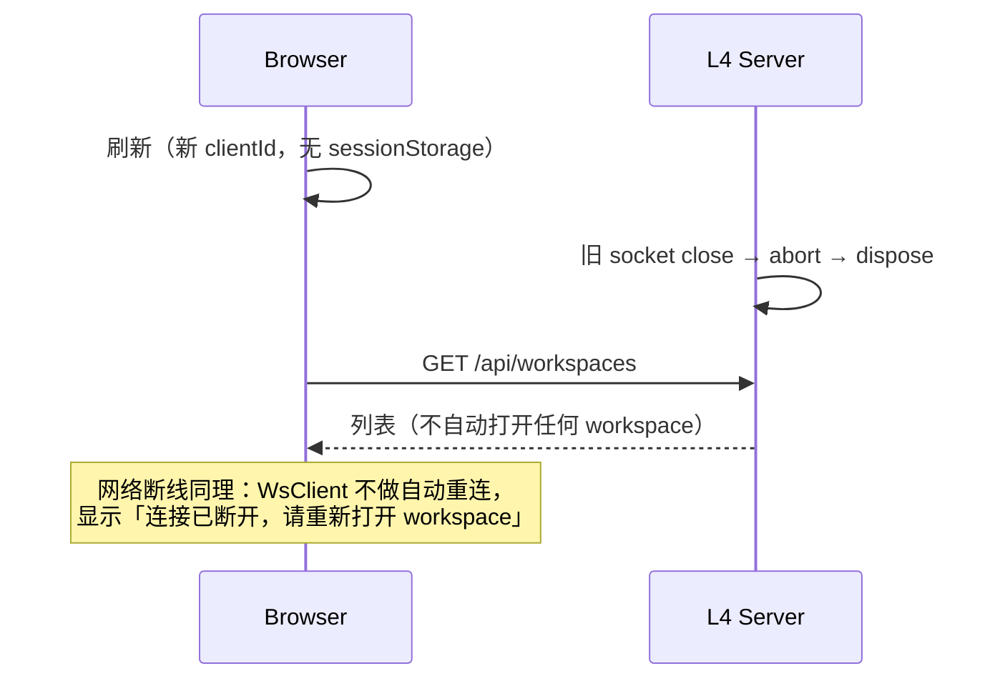

# html-harness 骨架方案设计（MVP）

> 本文只做**方案设计**，不含实现代码。
> 目标目录：`docs/pi/html-harness/`（与 [PRD.md](./PRD.md) 同级）。
>
> **范围**：只做「浏览器 ↔ pi AgentSession」的 MVP 骨架。PRD（页面设计器 / 素材 / 组件树 / Add To Context / 预览）**一律不在本阶段**。
> 骨架验收（§10）通过之前，不讨论、不设计、不实现 html-harness 的任何功能性需求。

---

## 1. 目标与非目标

### 目标（MVP）

1. 浏览器里能跟 pi 正常对话：流式文本、工具调用卡片、中断、队列（steer / followUp）。
2. **新建 / 打开 / 切换 workspace**：`PI_WEB_ROOT` 下的一级目录即 workspace；打开与切换都落在「一条新 WebSocket + 一个新 Runtime」上。
3. 扩展的对话框（`select / confirm / input / notify`）可用。
4. 一个可交付的构建：后端 `tsc`，前端 `vite build`。

### 非目标（MVP 明确不做）

- PRD 的任何功能。
- TUI、print/json/rpc 模式。
- `new_session` / `switch_session` / `fork` / `import`。
- **session 恢复**：没有 `?session=`，没有 `/tree` 入口，刷新即新会话。
- **目录记忆**：刷新后回到 workspace 列表，不自动重连上次的 workspace。
- **子目录浏览**：workspace 只能是 root 的一级目录，没有任意路径输入。
- 同一 workspace 多会话：一个客户端实例对一个 workspace 只开一条连接。
- 切换 workspace 时携带历史（**历史是新的**，见 §3.3）。
- 多用户鉴权、后台常驻会话、包管理 UI、主题系统、模型选择器。
- trust 交互提示、`.pi` 目录自动创建。

---

## 2. 分层与类型边界

五层，编号固定为 L0..L4。pi 的 `AgentSession` 是 **L2 的依赖**，不占层号。

| 层 | 内容 | 归属 | 对应 pi |
|---|---|---|---|
| L0 | 进程入口 / 配置 / root 校验 | 骨架 | `packages/coding-agent/src/main.ts`（只抄接线顺序） |
| L1 | `CwdServices`（cwd 绑定配置） | **骨架** | `core/agent-session-services.ts` |
| L2 | `WorkspaceRuntime`（一 workspace 一个 `AgentSession`，**无 switch**） | **骨架** | `core/agent-session-runtime.ts`（只抄 teardown 思想） |
| L3 | `Transport`（一条 WS 的封装：建/拆、原样转发事件） | **骨架** | `modes/rpc/rpc-mode.ts` |
| L4 | `Server`（HTTP、root/workspace、连接与 Runtime 的**编排**） | **骨架** | — |

职责边界的三种切法（这是本方案的核心）：

- **谁决定「何时」建/拆**：L4。它持有 `AbortController`、`clientId → 连接` 表，以及「新连接 `ready` 之后才拆旧连接」这条顺序。
- **谁执行「怎么」建/拆**：L3。`upgrade` 之后这条 socket 的读写、帧格式、`toWireEvent`、心跳应答。
- **谁懂 pi**：只有 L2。L4 不认识 `AgentSession`，不 import pi 的任何运行时导出；L3 只认识事件的**形状**（用于瘦身），不认识 Session 的动作。

**唯一 pi 依赖**：`@earendil-works/pi-coding-agent`。其余类型（`AgentMessage`、`ThinkingLevel`、`ImageContent`、`ExtensionBindings`…）全部从 `AgentSession` 的方法签名萃取，**不额外安装 `pi-ai` / `pi-agent-core`**（见 §5.4）。

两条类型级不变量：

1. `AgentSessionServices` 里没有 `session` → L1 可被 L2 随意重建。
2. `AgentSessionEvent` 里没有 UI 类型 → L3 可整体替换（React 壳不进入 pi）。

第三条规定性不变量（本版新增）：

3. **一条连接 = 一个 workspace = 一代**。cwd 在连接存活期内不可变，因此不需要任何代际（`gen`）概念。

### 2.1 架构图

```
┌──────────────────────────── Browser ─────────────────────────────┐
│  web/  React 19 + Vite + TypeScript                              │
│  ┌──────────────┐ ┌──────────┐ ┌───────────┐ ┌────────────────┐  │
│  │ WorkspaceList│ │Transcript│ │ Composer  │ │ExtensionDialog │  │
│  └──────┬───────┘ └────┬─────┘ └─────▲─────┘ └───────▲────────┘  │
│         └──────────────┴─────────────┴───────────────┘           │
│                     SessionStore (useSyncExternalStore)          │
│                     WsClient（单连接、无自动重连、seq 递增）        │
└───────────────────────────────┬──────────────────────────────────┘
   HTTP: GET / · /api/workspaces │ WS /ws?workspace=&clientId=
┌───────────────────────────────▼──────────────────────────────────┐
│ L4  src/web/server.ts                                            │
│  root 校验 · GET/POST /api/workspaces · upgrade 路由              │
│  leases: Map<clientId, Connection>   ← 决定何时建、何时拆         │
│  controller: AbortController         ← 唯一的取消入口             │
│  不 import pi                                                     │
└───────────────────┬──────────────────────────┬───────────────────┘
                    │ createRuntime(...)       │ createTransport(ws, runtime)
┌───────────────────▼──────────┐  ┌────────────▼───────────────────┐
│ L2  src/runtime.ts           │  │ L3  src/web/transport.ts       │
│  WorkspaceRuntime            │  │  Transport（一条 WS）           │
│  cwd 不可变、无 switch        │  │  toWireEvent（剥 partial）      │
│  subscribe → onEvent         │  │  seq 递增、帧收发                │
│  signal → session.abort()    │  │  C→S 命令 → Runtime 方法         │
│  UiPort → ExtensionUIContext │  │  ui_request / ui_response 路由   │
└──────┬───────────────────────┘  └────────────────────────────────┘
       │ createCwdServices(cwd) → createAgentSession(...)
┌──────▼──────────────────────────┐  ┌──────────────────────────────┐
│ L1  src/services.ts             │─►│  pi: createAgentSession       │
│  CwdServices { cwd, agentDir,   │  │      AgentSession / events    │
│    modelRuntime, settings,      │  └──────────────────────────────┘
│    resourceLoader, diag }       │
└──────┬──────────────────────────┘
       │ 复用（仅 agentDir 中的全局配置）
┌──────▼───────────────────────────────────────────────────────────┐
│ 进程级：root(realpath) · ModelRuntime · ProjectTrustStore         │
└──────────────────────────────────────────────────────────────────┘
```

### 2.2 进程内对象

```
main.ts
 ├─ root: string                        ← PI_WEB_ROOT 的 realpath（启动时校验）
 ├─ modelRuntime: ModelRuntime          ← 进程级唯一（复用 agentDir 配置）
 ├─ trustStore: ProjectTrustStore       ← 进程级唯一（agentDir/trust.json）
 └─ WebServer
      ├─ leases: Map<clientId, Connection>
      └─ Connection = { transport, runtime, controller }
           ├─ transport: L3（1 条 WS）
           ├─ runtime:   L2（1 个 AgentSession）
           └─ controller: AbortController（1 个）
```

打开/切换一个 workspace：**新建一个 `Connection`**（new WS + new Runtime + new controller），`ready` 之后销毁同一 `clientId` 的旧 `Connection`。没有「换代」，只有「换连接」。

### 2.3 事件流水线

```
AgentEvent → AgentSession（内部：落盘 / 压缩 / 重试 / 扩展钩子）
           → AgentSessionEvent
           → L2 Runtime.onEvent（原样，不做判断）
           → L3 toWireEvent（剥 message_update.partial、白名单）
           → { v, seq, type } → WS → SessionStore
```

`partial` 的剥除留在 L3：它是一次纯载荷瘦身（一条 500 token 的回复，若原样带 `partial`，带宽从 O(n) 变成 O(n²)），不是业务改写。

---

## 3. 关键时序

### 3.1 打开 workspace



root 不存在 / workspace 名非法 / 目录不是 root 的直接子目录 → 新 WS 收到 `error` 后立刻关闭，**不建立任何 Runtime**。

### 3.2 一轮 prompt



### 3.3 切换 workspace（唯一的重建动作）



顺序是**先建新的、再拆旧的**：失败时天然回滚，不需要任何补偿逻辑。这也是「切换失败后用户回到原处」这一行为的唯一实现方式。

`clientId` 在页面实例内生成、只存内存：刷新等于新的客户端实例，旧连接由旧 socket 的 `close` 事件清理。

### 3.4 刷新 / 断线



**不做自动重连**是有意的：既然没有 session 恢复，自动重连等于静默地开一个新会话并丢掉历史，用户会以为「对话还在」。断线必须是一次显式的用户动作。

---

## 4. 技术栈与目录

| 部分 | 选型 |
|---|---|
| 后端 | Node 22+、**TypeScript 由 `tsc` 编译**到 `dist-server/`（ESM + NodeNext） |
| 前端 | **React 19 + Vite + TypeScript** |
| 共享 | `shared/protocol.ts`：线格式类型，前后端同时编译 |
| 唯一 pi 依赖 | `@earendil-works/pi-coding-agent` |

```
examples/skeleton/
├── package.json
├── tsconfig.server.json        # NodeNext → dist-server，编译 src + shared
├── vite.config.ts              # root=web，proxy /api /ws → :8787
├── shared/
│   └── protocol.ts             # ClientMessage / ServerMessage / 类型萃取
├── src/                        # 后端
│   ├── main.ts                 # L0：root 校验 + 进程级对象 + 监听
│   ├── config.ts               # L0：3 个环境变量
│   ├── workspaces.ts           # L4 的路径域模型：root + name → realpath
│   ├── services.ts             # L1：createCwdServices()
│   ├── runtime.ts              # L2：createRuntime()（无 switch）
│   └── web/
│       ├── server.ts           # L4：HTTP + upgrade + leases + 生命周期
│       ├── transport.ts        # L3：一条 WS 的收发与事件转发
│       ├── events.ts           # L3：toWireEvent()
│       └── ui.ts               # L3：UiPort 的 WS 实现（扩展 UI 桥）
├── web/                        # 前端（Vite root）
│   ├── index.html
│   ├── tsconfig.json
│   └── src/
│       ├── main.tsx
│       ├── App.tsx
│       ├── ws-client.ts
│       ├── store.ts            # useSyncExternalStore
│       ├── api.ts              # /api/workspaces
│       ├── app.css
│       └── components/
│           ├── WorkspaceList.tsx      # 列表 + 新建 + 切换确认
│           ├── Transcript.tsx
│           ├── Composer.tsx
│           ├── StatusBar.tsx
│           ├── ExtensionDialog.tsx
│           └── DiagnosticsBar.tsx
└── test/
    ├── workspaces.test.ts       # 名字校验 / 一级目录 / 符号链接逃逸（node:test）
    └── runtime.test.ts          # signal → abort → dispose 幂等（node:test）
```

依赖与脚本（保持最少）：

```jsonc
{
  "type": "module",
  "scripts": {
    "dev": "concurrently -k \"npm:dev:server\" \"npm:dev:web\"",
    "dev:server": "tsc -p tsconfig.server.json && node dist-server/src/main.js",
    "dev:web": "vite",
    "build": "tsc -p tsconfig.server.json && tsc -p web/tsconfig.json --noEmit && vite build",
    "test": "tsc -p tsconfig.server.json && node --test \"dist-server/test/*.test.js\"",
    "start": "node dist-server/src/main.js"
  },
  "dependencies": {
    "@earendil-works/pi-coding-agent": "1.1.0",
    "react": "^19.0.0",
    "react-dom": "^19.0.0",
    "ws": "^8.18.0"
  },
  "devDependencies": {
    "@types/node": "^22.0.0",
    "@types/react": "^19.0.0",
    "@types/react-dom": "^19.0.0",
    "@types/ws": "^8.5.0",
    "@vitejs/plugin-react": "^4.3.0",
    "concurrently": "^9.0.0",
    "typescript": "^5.7.0",
    "vite": "^6.0.0"
  }
}
```

> `tsconfig.server.json` 用 `module: "NodeNext"` + `verbatimModuleSyntax: true`，后端代码里的相对导入必须写 `.js` 后缀。MVP 不做后端增量 watch：改完后端代码后重启 `npm run dev`。

---

## 5. 各层设计

### 5.1 L0 入口（`src/main.ts` + `src/config.ts`）

配置只有 3 个环境变量：

| 名称 | 默认值 | 说明 |
|---|---|---|
| `PI_WEB_PORT` | `8787` | 监听端口（固定 `127.0.0.1`） |
| `PI_WEB_ROOT` | `process.cwd()` | **唯一的** workspace 根；所有 workspace 都是它的一级子目录 |
| `PI_AGENT_DIR` | `getAgentDir()` | 全局配置目录（auth / models / settings / sessions / trust） |

没有 CLI flag，没有 `.env` 解析，**没有多个 root**。

```ts
// 进程级（只复用 agentDir 里的全局配置）
const agentDir = process.env.PI_AGENT_DIR ?? getAgentDir();
const modelRuntime = await ModelRuntime.create({
  authPath: join(agentDir, "auth.json"),
  modelsPath: join(agentDir, "models.json"),
});
const trustStore = new ProjectTrustStore(agentDir);

// root：不存在则创建，然后 realpath 固化（后续一切比较都基于它）
const root = await resolveWorkspaceRoot(process.env.PI_WEB_ROOT ?? process.cwd());
// 失败 → console.error + exit(1)：带着坏 root 起服务只会让所有请求都变成 WORKSPACE_NOT_FOUND

const server = createWebServer({ root, agentDir, modelRuntime, trustStore });
server.listen(Number(process.env.PI_WEB_PORT ?? 8787), "127.0.0.1");
process.on("SIGINT", () => void shutdown(0));
process.on("SIGTERM", () => void shutdown(0));
```

`shutdown()`：对每个 `Connection` `controller.abort()` → `await runtime.dispose()` → `server.close()` → `exit`。

### 5.2 L1 `CwdServices`（`src/services.ts`，与上一版相同）

**唯一职责**：给定一个 cwd，构造该目录的完整配置。可反复调用，无缓存，无跨 cwd 副作用。

```ts
// 与 SDK 的 AgentSessionServices 结构对齐（字段完全覆盖）
interface CwdServices {
  cwd: string;
  agentDir: string;
  modelRuntime: ModelRuntime;
  settingsManager: SettingsManager;
  resourceLoader: ResourceLoader;
  diagnostics: Diagnostic[];
}

async function createCwdServices({ cwd, agentDir, modelRuntime, trustStore }): Promise<CwdServices>;
```

构造顺序（不可变）：

1. `cwd` 已由 L4 校验成 realpath（必须是 root 的直接子目录）。
2. `trusted = !hasTrustRequiringProjectResources(cwd) || trustStore.get(cwd) === true`。
3. `settingsManager = SettingsManager.create(cwd, agentDir, { projectTrusted: trusted })`。
4. `resourceLoader = new DefaultResourceLoader({ cwd, agentDir, settingsManager })`。
5. `await resourceLoader.reload()`（扩展在这里执行并注册工具/命令）。
6. 把 `extensionsResult.runtime.pendingProviderRegistrations` / `pendingNativeProviderRegistrations` 灌入 `modelRuntime`；逐项 `try/catch → diagnostics`；灌完清空。
7. `await modelRuntime.refresh({ allowNetwork: false })`。
8. 返回。

**复用边界（硬规则）**：

| 跨 workspace 复用 | 每次重建 |
|---|---|
| `agentDir` 里的全局配置：`ModelRuntime`（auth/models 目录）、`ProjectTrustStore` | `SettingsManager`（会重新读全局 + 该目录 `.pi/settings.json`） |
| — | `DefaultResourceLoader`（extensions / skills / prompts / themes / AGENTS.md / SYSTEM.md） |
| — | trust 判定、model scope、systemPrompt、tools、session 文件 |

没有项目配置时不报错：用全局配置，并推一条 `info` 诊断。骨架**不创建** `.pi/`。

### 5.3 pi `AgentSession` 使用契约（L2 的依赖）

```ts
const { session, modelFallbackMessage } = await createAgentSession({
  cwd: services.cwd,
  agentDir: services.agentDir,
  modelRuntime: services.modelRuntime,
  settingsManager: services.settingsManager,
  resourceLoader: services.resourceLoader,   // 已 reload，SDK 不会重复 reload
  sessionManager,                            // SessionManager.create(cwd)
  scopedModels,                              // resolveModelScopeWithDiagnostics 的结果
  sessionStartEvent: { type: "session_start", reason: "startup" },
});
```

不传 `model` / `thinkingLevel` / `tools`：由 SDK 从 settings 恢复默认。
**不使用** `SessionManager.open()`：骨架没有 session 恢复。

MVP 只调用这些方法：

| 用途 | 调用 |
|---|---|
| 输入 | `prompt(text, opts)`、`steer()`、`followUp()`、`abort()`、`waitForIdle()` |
| 状态 | `messages`、`model`、`thinkingLevel`、`isStreaming`、`sessionId`、`sessionFile` |
| 事件 | `subscribe()`、`bindExtensions()` |
| 生命周期 | `dispose()`（只有 L2 调） |

`prompt()` 语义（L2 必须照做）：

```ts
void session.prompt(text, {
  source: "rpc",
  images,
  streamingBehavior: session.isStreaming ? (behavior ?? "steer") : undefined,
  preflightResult: (ok) => { if (!ok) onError({ code: "PROMPT_REJECTED" }); },
}).catch(err => onError({ code: "INTERNAL", message: String(err) }));
```

- `prompt()` 在**整轮结束**后才 resolve，所以不能 await 再回包。
- 流式中不传 `streamingBehavior` 会抛错。
- `/cmd`、prompt template、skill 的展开由 `prompt()` 内部完成。

事件 → 线格式（L3 白名单，MVP 只处理这些）：

| 事件 | 处理 | 前端 |
|---|---|---|
| `message_start` / `message_end` | 原样（带完整 message） | 建 / 定格气泡 |
| `message_update` | **剥 `assistantMessageEvent.partial`** | 增量文本 |
| `tool_execution_start` / `end` | 原样 | 工具卡片 |
| `tool_execution_update` | 丢弃 | — |
| `agent_start` / `agent_end` / `agent_settled` | 原样 | 忙碌 / 解锁（以 `agent_settled` 为准） |
| `queue_update` | 转成独立的 `queue` 帧 | 队列徽标 |
| `compaction_start` / `end`、`auto_retry_start` / `end` | 原样 | 提示 |
| 其他（`entry_appended`、`session_info_changed`…） | 丢弃 | — |

### 5.4 类型萃取（不装额外 pi 包）

```ts
import type { AgentSession, AgentSessionEvent, JsonAgentSessionEvent } from "@earendil-works/pi-coding-agent";

type WireEvent = JsonAgentSessionEvent;
type AgentMessage = AgentSession["messages"][number];
type ThinkingLevel = AgentSession["thinkingLevel"];
type Model = NonNullable<AgentSession["model"]>;
type PromptImages = NonNullable<NonNullable<Parameters<AgentSession["prompt"]>[1]>["images"]>;
type ExtensionBindings = Parameters<AgentSession["bindExtensions"]>[0];
```

`shared/protocol.ts` 被前后端同时编译，因此**只允许 `import type`**（`verbatimModuleSyntax` 保证擦除），pi 不会进入前端 bundle。

### 5.5 L2 `WorkspaceRuntime`（`src/runtime.ts`）

**唯一持有一个 `AgentSession` 的层，也是唯一 import pi 运行时导出的层。** 没有 `switchCwd`、没有 `Generation`、没有 `onGeneration`、没有 `id`。

```ts
interface UiPort {
  request(method: UiMethod, payload: Record<string, unknown>, opts?: { signal?: AbortSignal; timeout?: number }): Promise<UiResponse | undefined>;
  notify(message: string, level?: "info" | "warning" | "error"): void;
  setStatus(key: string, text: string | undefined): void;
  setTitle(title: string): void;
  setEditorText(text: string): void;
  closeAll(): void;              // 把 pending 全部 resolve(fallback)
}

interface CreateRuntimeOptions {
  cwd: string;                   // 已由 L4 校验
  agentDir: string;
  modelRuntime: ModelRuntime;
  trustStore: ProjectTrustStore;
  signal: AbortSignal;           // 由 L4 持有的 AbortController
  ui: UiPort;                    // 由 L3 实现
  onEvent: (event: AgentSessionEvent) => void;
  onDiagnostic: (diagnostic: Diagnostic) => void;
  onShutdownRequest: () => void; // 扩展 ctx.shutdown()
}

interface WorkspaceRuntime {
  readonly cwd: string;
  readState(): SessionState;     // cwd/model/thinking/isStreaming/sessionId/sessionFile/messageCount
  readMessages(): AgentMessage[];
  prompt(text: string, options?: { images?: PromptImages; behavior?: "steer" | "followUp" }): void;
  steer(text: string): Promise<void>;
  followUp(text: string): Promise<void>;
  abort(): Promise<void>;        // session.abort()（UI 的 Stop 按钮）
  dispose(): Promise<void>;      // await waitForIdle() → session.dispose()
}
```

内部构造（一代一次，失败即抛，由 L4 决定回退）：

```
services  = await createCwdServices({ cwd, agentDir, modelRuntime, trustStore })
{ scopedModels, diagnostics } = await resolveModelScopeWithDiagnostics(
                                 services.settingsManager.getEnabledModels() ?? [], modelRuntime)
session   = await createAgentSession({ ..., sessionManager: SessionManager.create(cwd),
                                       sessionStartEvent: { type: "session_start", reason: "startup" } })
unsubscribe = session.subscribe(onEvent)          // 原样透传，不做判断
await session.bindExtensions(toBindings({ ui, signal, onError, onShutdownRequest }))
signal.addEventListener("abort", () => void session.abort())
```

`toBindings()` 就是 `bindExtensions` 的实参，pi 类型只在这一层出现：

```ts
{
  uiContext: toExtensionUIContext(ui),   // UiPort → ExtensionUIContext 适配
  mode: "rpc",
  abortHandler: () => void session.abort(),
  shutdownHandler: () => onShutdownRequest(),
  onError: (e) => onDiagnostic({ type: "error", message: `Extension "${e.extensionPath}" (${e.event}): ${e.error}` }),
  commandContextActions: {
    waitForIdle: () => session.waitForIdle(),
    newSession: async () => ({ cancelled: true }),      // 桩
    fork: async () => ({ cancelled: true }),            // 桩
    switchSession: async () => ({ cancelled: true }),   // 桩
    navigateTree: async (id, o) => ({ cancelled: (await session.navigateTree(id, o)).cancelled }),
    reload: () => session.reload(),
  },
}
```

**拆解契约（仿 `packages/agent/src/agent.ts` 的 `runWithLifecycle`）**：一个 controller 配一次运行，signal 透传，收尾只有一条路径。

```ts
// L4 侧调用，L2 侧执行
controller.abort();            // 唯一取消入口
await runtime.dispose();       // 内部：unsubscribe → ui.closeAll() → waitForIdle(超时 5s) → session.dispose()
```

`dispose()` 内部**不**调 `session.abort()`：abort 只走 `signal`。因此唯一正确顺序是「先 `controller.abort()`，再 `dispose()`」；`waitForIdle` 套 5s 超时，避免上层漏调 abort 时永久挂起（超时后照常 dispose，并推一条 `warning` 诊断）。

`signal` 的三个消费点：

1. `session.abort()` 由 `signal` 的 `abort` 监听触发 —— 不在销毁处散着调 abort。
2. `onEvent` 转发前由 L3 检查 `signal.aborted`，拆解期不再发帧。
3. `UiPort` 的 pending 对话框收到 abort → `resolve(fallback)`（`undefined` / `false`），不 reject。

必须走 `session.abort()` 而不能自己造 signal：pi 的 turn 只认自己的 `activeRun.abortController`，外部 signal 传不进去（`agent.abort()` 等价于 `activeRun?.abortController.abort()`）。

### 5.6 L3 `Transport`（`src/web/transport.ts` + `events.ts` + `ui.ts`）

一条 WS 一个 `Transport`。它不知道 Runtime 是怎么造出来的，也不知道 workspace 是什么。

```ts
interface Transport {
  readonly ui: UiBridge;                        // = UiPort + handleResponse，L4 把它交给 createRuntime
  sendHello(workspace: string, cwd: string): void;
  sendReady(runtime: WorkspaceRuntime): void;   // state + messages + diagnostics
  sendDiagnostic(diagnostic: Diagnostic): void;
  sendError(code: ErrorCode, message: string): void;
  onEvent(event: AgentSessionEvent): void;
  attach(runtime: WorkspaceRuntime): void;      // 之后才开始接受 C→S 命令
  close(): Promise<void>;                       // 只关 socket；Runtime 的销毁是 L4 的顺序
}

function createTransport(options: { ws: WebSocket; signal: AbortSignal }): Transport;
```

职责：

- **出**：Runtime 的 `onEvent` → `toWireEvent` → `{ v, seq, type: "event", event }`；`queue_update` → `queue` 帧；`seq` 在连接内单调递增（只用于日志与丢帧判断，不需要做代际过滤）。
- **入**：解析 `ClientMessage` 并翻成 Runtime 方法调用 —— `prompt / steer / follow_up / abort / ping / ui_response`。非法 JSON 或未知类型 → `BAD_REQUEST`。
- `ui.ts` 实现 `UiPort`：`request()` 发 `ui_request` 并等 `ui_response`；支持 `signal` / `timeout`，到点 `resolve(fallback)`。
- 心跳：`ping` → `pong`。
- 拆解：`close()` 只关 socket；pending UI 请求由 §5.5 的 signal 路径收尾。

「原样转发」的边界（唯一一处有意的改写）：`toWireEvent` 剥 `partial` 与丢弃非白名单事件。原因见 §2.3；除此之外不改任何事件的语义。

### 5.7 L4 `Server`（`src/web/server.ts`）

```ts
interface WebServerOptions {
  root: string;                  // realpath
  agentDir: string;
  modelRuntime: ModelRuntime;
  trustStore: ProjectTrustStore;
  webDist: string;
}
```

职责（**不 import pi**）：

1. **HTTP**：SPA 静态资源、`GET /api/workspaces`、`POST /api/workspaces`。
2. **upgrade 路由**：只接受 `/ws`，把 `workspace` / `clientId` 交给 workspace 域模型校验。
3. **leases**：`Map<clientId, Connection>`，覆盖式（同一 `clientId` 只留最新一条）。
4. **编排顺序**：
   ```
   resolveWorkspace(root, name)        // 失败 → error + close（无 Runtime）
   runtime = await createRuntime(...)  // 失败 → error + close（旧 Connection 不动）
   transport = createTransport(ws, runtime, signal)
   transport.sendReady(runtime, diagnostics)
   const previous = leases.get(clientId)
   leases.set(clientId, { transport, runtime, controller })
   await closeConnection(previous)     // abort → dispose → transport.close()
   ```
5. **`closeConnection(c)`**：`c.controller.abort()` → `await c.runtime.dispose()` → `await c.transport.close()`。
6. **socket `close` / 服务端 `shutdown`**：同样走 `closeConnection`，幂等。
7. **`POST /api/workspaces` 的同源校验**：`Sec-Fetch-Site` 只接受 `same-origin`/`none`，且 `Origin` 的 host 必须等于 `Host`，否则 `403 FORBIDDEN_ORIGIN`。这是骨架唯一有副作用的写端点。

`workspaces.ts` 的域模型（三个函数，全部相对 `root`）：

```ts
resolveWorkspaceRoot(raw: string): Promise<string>          // mkdir -p → realpath，失败抛
listWorkspaces(root: string): Promise<WorkspaceEntry[]>     // 一级目录，跳过 . 前缀 / 非目录 / 逃逸符号链接
createWorkspace(root: string, name: string): Promise<WorkspaceEntry>   // mkdir，同名 → WORKSPACE_EXISTS
resolveWorkspace(root: string, name: string): Promise<string>          // 校验 + realpath + 父目录 === root
```

**MVP 的能力边界（有意为之）**：

| 能力 | MVP |
|---|---|
| 新建 / 打开 / 切换 workspace、重建配置 | ✅ |
| 切换 workspace 保留历史 | ❌（新连接 = 新会话） |
| 刷新/重连恢复会话 | ❌（回列表，新会话） |
| `new_session` / `switch_session` / `fork` | ❌ |
| 扩展 `session_shutdown` / `session_before_switch` | ❌（只 `dispose()`，旧扩展 ctx 立即 stale） |
| 扩展 `ctx.newSession / fork / switchSession` | 桩：返回 `{ cancelled: true }` |
| 扩展 `ctx.reload()` | ✅（`session.reload()`） |

> 以后要加 new / resume / fork，按 pi 的 `AgentSessionRuntime` 在 **L2** 扩展 `WorkspaceRuntime` 即可；L1/L3/L4 不动。

---

## 6. L4/L3 的对外契约（Web）

### 6.1 路由

| 方法 | 路径 | 说明 |
|---|---|---|
| `GET` | `/` | dev: Vite :5173；prod: `web-dist/index.html`（Node 做 SPA fallback） |
| `GET` | `/api/workspaces` | `{ root, workspaces: [{name, path}] }` |
| `POST` | `/api/workspaces` | body `{ name }` → `201 {name, path}`；同名 `409 WORKSPACE_EXISTS`；非法 `400 BAD_WORKSPACE_NAME`；跨源 `403 FORBIDDEN_ORIGIN` |
| `WS` | `/ws?workspace=&clientId=` | 唯一命令通道；`workspace` 缺失或非法 → 握手后 `error` + close |

命令全走 WS（会话有状态，双通道会乱序）；HTTP 只读（`POST /api/workspaces` 是唯一的写操作）。

没有子目录浏览：`/api/dirs`、`?path=`、`parent` 全部移除。workspace 只能是 root 的一级目录。

### 6.2 线格式（`shared/protocol.ts`）

```ts
interface Envelope { v: 1; seq: number }

export type ClientMessage =
  | { type: "prompt"; text: string; images?: PromptImages; behavior?: "steer" | "followUp" }
  | { type: "steer"; text: string }
  | { type: "follow_up"; text: string }
  | { type: "abort" }
  | { type: "ui_response"; id: string; response: UiResponse }
  | { type: "ping" };

export type ServerMessage =
  | (Envelope & { type: "hello"; workspace: string; cwd: string })
  | (Envelope & { type: "ready"; state: SessionState; messages: AgentMessage[]; sessionFile?: string })
  | (Envelope & { type: "event"; event: WireEvent })
  | (Envelope & { type: "queue"; steering: string[]; followUp: string[] })
  | (Envelope & { type: "ui_request"; id: string; method: UiMethod; payload: Record<string, unknown> })
  | (Envelope & { type: "diagnostic"; diagnostic: Diagnostic })
  | (Envelope & { type: "error"; code: ErrorCode; message: string })
  | (Envelope & { type: "pong" });

export interface SessionState {
  cwd: string;
  model?: { provider: string; id: string; name?: string };
  thinkingLevel: ThinkingLevel;
  isStreaming: boolean;
  sessionId: string;
  sessionFile?: string;
  messageCount: number;
}
```

规则：

- **没有 `gen`**：一条连接只有一代，切 workspace 就是换连接，旧连接的所有帧都随 socket 关闭而终结。
- `ready` 是唯一全量快照，**一条连接只发一次**（首连即全部；没有「同连接内再 ready」的情况）。
- 状态从 `ready` + 事件推导（`agent_start` → 忙碌，`agent_settled` → 空闲），不做 `get_state` / `ack`。
- 没有 `switch_cwd`：切换 = 前端新开一条 WS，走 §3.3。

### 6.3 扩展 UI（`src/web/ui.ts`）

| 方法 | 行为 |
|---|---|
| `select` / `confirm` / `input` / `editor` | 发 `ui_request`，等 `ui_response`；支持 `signal` / `timeout`，到点 resolve 成 `undefined/false`（**不 reject**） |
| `notify` / `setStatus` / `setTitle` / `setEditorText` | fire-and-forget |
| `setWidget` / `setFooter` / `setHeader` / `onTerminalInput` / `setEditorComponent` / `custom` … | no-op（Web 无终端） |
| `theme` | 透传对象（`fg/bg/bold` 返回原文），防扩展崩溃 |

拆解时把所有 pending 请求 `resolve(fallback)`（由 `signal` 触发的 `closeAll()`），否则扩展会永久挂起。

### 6.4 前端（React + Vite + TS）

| 模式 | 入口 | 后端 | 说明 |
|---|---|---|---|
| dev | Vite :5173 | `node` :8787 | `server.proxy`: `/api` → 8787，`/ws` → `ws://127.0.0.1:8787`（`ws: true`） |
| prod | Node 服务 `web-dist/` | :8787 | 同源；WS URL 由 `location.host` 推导，零环境变量 |

```ts
// vite.config.ts
export default defineConfig({
  root: "web",
  plugins: [react()],
  resolve: { alias: { "@shared": fileURLToPath(new URL("../shared", import.meta.url)) } },
  server: { proxy: {
    "/api": "http://127.0.0.1:8787",
    "/ws": { target: "ws://127.0.0.1:8787", ws: true },
  } },
  build: { outDir: "../web-dist", emptyOutDir: true },
});
```

状态模型（`store.ts`，不进 React 树）：

```
connection: "idle" | "connecting" | "open" | "closed"   // idle = 还没打开任何 workspace
clientId: string                                        // 页面实例内生成，只存内存
workspaces: WorkspaceEntry[]  root: string
workspace?: string            state?: SessionState
messages: AgentMessage[]
streamingText: string         // rAF 合帧更新
tools: Map<toolCallId, ToolView>
queue: { steering, followUp }
uiRequests: UiRequest[]
diagnostics: Diagnostic[]
switching: boolean            // 提交切换后的本地门闩（见下）
```

- **无自动重连**：`WsClient` 只在用户动作（打开/切换 workspace）时连接；`close` → `connection: "closed"`，UI 提示「连接已断开，请重新打开 workspace」。心跳保留，用于尽早发现死连接。
- **无 `sessionStorage` / `localStorage`**：不记目录、不记 session 文件。刷新回到列表页。
- `getSnapshot` 必须返回稳定引用（变更时整片替换）。
- 组件用 selector 订阅切片；`message_update` 只触发流式气泡重渲。
- `switching` 是**前端本地**门闩：提交切换后置位（Composer 禁用、WorkspaceList 禁用），新连接 `ready` 或 `error` 时清除。它不是旧方案的 `replacing` —— 那个是服务端门闩，且服务于同连接内换代；这里挡的是「切换握手期间把 prompt 发到即将被销毁的旧连接」这一个前端竞态。

组件（MVP 全部）：

| 组件 | 职责 |
|---|---|
| `<App>` | 布局；`connection === "idle"` 时渲染 workspace 列表 |
| `<WorkspaceList>` | `GET /api/workspaces` 的列表；选择 → 确认弹框 → 建连接 |
| `<NewWorkspace>` | 输入 name → `POST /api/workspaces` → 成功后立即打开（= 建连接） |
| `<Transcript>` | 消息 + 流式文本 + 工具卡片；自动滚底（上滚时暂停） |
| `<Composer>` | Enter 发送 / Alt+Enter followUp / Esc abort；流式默认 steer |
| `<StatusBar>` | workspace 名、model、thinking、streaming、队列 |
| `<ExtensionDialog>` | `ui_request` 模态框 |
| `<DiagnosticsBar>` | info / warning / error |

---

## 7. 错误、诊断与安全

### 7.1 错误码

| code | 触发 |
|---|---|
| `BAD_REQUEST` | JSON 非法 / 字段缺失 / 未知消息类型 |
| `BAD_WORKSPACE_NAME` | name 为空、含 `/` `\`、以 `.` 开头、是 `.`/`..` |
| `WORKSPACE_NOT_FOUND` | root 下没有这个一级目录，或它不是目录 |
| `WORKSPACE_EXISTS` | 新建时同名目录已存在（`409`） |
| `FORBIDDEN_PATH` | realpath 后父目录不是 root（含符号链接逃逸） |
| `FORBIDDEN_ORIGIN` | `POST /api/workspaces` 来自非同源的页面 |
| `WORKSPACE_OPEN_FAILED` | 新 workspace 的配置/会话构建失败（**旧连接与旧 Runtime 保留**） |
| `PROMPT_REJECTED` | `preflightResult(false)` |
| `NO_MODEL` | 没有可用模型（未登录） |
| `INTERNAL` | 其他（日志带堆栈，前端只显示 message） |

### 7.2 诊断

复用 `AgentSessionRuntimeDiagnostic`（`{ type, message }`）：`info` 灰条 / `warning` 黄条 / `error` 红条。典型的 `info`：新 workspace 没有 `.pi` 配置。

### 7.3 安全

1. 只监听 `127.0.0.1`，无鉴权，不暴露公网。
2. **workspace 路径校验**：`realpath` 后父目录必须**等于** `root`（不是「以 root 为前缀」）。这一条同时堵住 `..` 与符号链接逃逸，也是「所有 workspace 都在 root 下」这句要求的唯一落地点。
3. `listWorkspaces` 跳过 `.` 前缀目录与所有非目录文件；`realpath` 后逃出 root 的符号链接不计入列表。
4. `POST /api/workspaces` 校验 `Origin` / `Sec-Fetch-Site`：同机任意页面都能打 127.0.0.1，写端点必须限同源。
5. 项目 `.pi/` 扩展 = 任意代码执行；未 trust 的目录不加载项目资源。
6. `bash` 工具 = 远程命令执行；MVP 不做沙箱。

---

## 8. 设计决策

| # | 决策 | 理由 |
|---|---|---|
| D1 | L2 用 SDK，L1/L3/L4 自写 | 验证「换 L3/L4 不动 pi」，同时掌控 cwd/trust/ModelRuntime |
| D2 | **连接 = workspace = 一代**，Runtime 无 `switchCwd` | 切换必然要重建配置与会话，那就连连接一起重建：协议里省掉 `gen`、`switch_cwd`、`replacing`、`onSwap` |
| D3 | **先建新连接、`ready` 之后才拆旧连接** | 失败天然回滚，不需要状态机或补偿逻辑（薄的关键），用户看到的是「切不过去就留在原地」 |
| D4 | 重配置只复用 `agentDir` 全局配置 | 其余全部重建；配置与 cwd 强绑定，复用旧 loader/settings 必错 |
| D5 | 切换 = 新会话（新 session 文件） | 语义干净；`SessionManager.create(newCwd)`，不做 header 覆盖 |
| D6 | `ModelRuntime` / `ProjectTrustStore` / `root` 进程级唯一 | 三者只读全局配置与 root，属允许的复用 |
| D7 | **不做 session 恢复、不做目录记忆** | 骨架的核心是「连接/切换」这条链路；恢复会引入 `?session=`、路径白名单、store 持久化三处额外逻辑，不是核心功能 |
| D8 | **不做自动重连** | 没有恢复能力时的自动重连 = 静默开新会话并丢历史；断线必须是显式动作 |
| D9 | `clientId` 存内存 + 服务端覆盖式 lease | tab 级身份够用；不落 storage，避免刷新后「认领」旧连接 |
| D10 | 取消统一走 `AbortController` + signal 透传 | 仿 `runWithLifecycle`：一个 controller 配一次运行，收尾只有一条路径；`session.abort()` 由 listener 触发，不在休眠处散调 |
| D11 | 事件瘦身（剥 `partial`）留在 L3 | 「原样转发」= 不改语义；`partial` 是 O(n²) 带宽，不是语义 |
| D12 | 前后端共享 `shared/protocol.ts`，仅 `import type` | 单一契约、两端 `tsc` 校验；pi 不进前端 bundle |
| D13 | 后端 `tsc` 产物直跑；前端 Vite | 用户指定栈；不引入 bundler/打包器给后端 |
| D14 | 扩展的 new/fork/switch 用桩 | 这些能力不在 MVP |
| D15 | trust 无交互、不创建 `.pi` | Web 没有启动期提示；目录初始化属于 PRD |
| D16 | workspace 只能是 root 的一级目录 | 路径校验从「前缀匹配」退化成「父目录相等」，一次比较堵住 `..` 与符号链接；也让 UI 只需要「列表」而不需要「文件浏览器」 |

---

## 9. 与 pi 的参考点

| pi 位置 | 抄什么 | 骨架落点 |
|---|---|---|
| `src/main.ts` · `createRuntime` 闭包 | 「cwd → services → model scope → session」的顺序 | `src/runtime.ts` 的 `createRuntime()` |
| `core/agent-session-services.ts` | `loader.reload → 注册 provider → refresh(no network) → diagnostics` | `src/services.ts` |
| `core/agent-session-runtime.ts` · `teardownCurrent` | abort → waitForIdle → dispose 的**顺序**（MVP 砍掉 before/shutdown 事件） | `src/runtime.ts` 的 `dispose()` |
| `packages/agent/src/agent.ts` · `runWithLifecycle` | controller + signal 透传 + `finally` 收尾 | `src/web/server.ts` 的 `controller` 与 `src/runtime.ts` 的 abort 监听 |
| `modes/rpc/rpc-mode.ts` · `createDialogPromise` | signal / timeout / fallback | `src/web/ui.ts` |
| `modes/rpc/rpc-mode.ts` · `rebindSession` | `bindExtensions` 的字段组合 | `src/runtime.ts` 的 `toBindings()` |
| `modes/json-event.ts` · `toJsonEvent` | 剥 `partial` | `src/web/events.ts` |
| `core/session-manager.ts` | 直接用，不复制 | SDK |

---

## 10. 验收（骨架 Done）

| # | 验收项 | 方式 |
|---|---|---|
| A1 | 浏览器输入一句话，assistant 文本逐字流式出现，内容正确 | 手工 |
| A2 | 触发 `read` / `bash`，工具卡片 start → end 正确 | 手工 |
| A3 | 流式中发第二条消息（默认 steer）、Alt+Enter 走 followUp、Stop 能中止并保留已生成内容 | 手工 |
| A4 | **切换 workspace**：确认后新 WS 建立、`ready` 里 cwd 是新目录、旧 WS 被关闭、旧 Runtime 已 dispose；`bash pwd` 在新目录；新目录 `.pi` 与 `AGENTS.md` 生效；旧目录扩展已卸载；历史清空 | 手工（server 日志看 `close`） |
| A5 | **新建 workspace**：`POST /api/workspaces` 建出目录、立即打开；同名再建 → `409`；非法 name → `400` | 手工 |
| A6 | **切换失败回退**：切到配置坏掉/无权限的目录，新连接收 `error` 并关闭，界面与连接留在原 workspace，输入框恢复可用 | 手工 |
| A7 | 刷新页面：回到 workspace 列表，旧连接被服务端清理（无残留 Runtime） | 手工 |
| A8 | 一个只调用 `ctx.ui.confirm()` 的扩展能弹框并返回，不挂起；切换 workspace 时挂着的弹框不阻塞拆解 | 手工 |
| A9 | `npm run build` 通过；`npm start` 同源提供 `web-dist` + `/api` + `/ws` | 命令 |
| A10 | `npm test` 全绿：`workspaces.test.ts`（名字校验、一级目录、符号链接逃逸、同名 409）+ `runtime.test.ts`（signal → abort → dispose 幂等） | 命令 |

---

## 11. 里程碑

| 里程碑 | 内容 | 完成标志 |
|---|---|---|
| M0 | L1 + L2：一个 `smoke.ts` 直接 `createCwdServices → createAgentSession → prompt` 打印流式文本 | 终端看到回复 |
| M1 | L3/L4 + 前端：workspace 列表、`/ws`、`ready/event/error`、Transcript / Composer / StatusBar | A1~A3 通过 |
| M2 | 新建/切换 workspace + 拆旧连接 + 扩展 UI + prod 构建 | A4~A10 通过；**骨架完成** |

M2 之后才开 PRD 的设计与实现（另立 `HARNESS.md`）。接入点：在 `web/` 里加页面/素材视图与只读 API；L1~L3 与协议不应再改。

---

## 12. 风险

| 风险 | 对策 |
|---|---|
| 旧连接销毁时 turn 还在跑 | `signal` → `session.abort()` → `waitForIdle()` → `dispose()`；`waitForIdle` 之前套超时，超时后强制 `dispose()` 并记诊断 |
| 切换握手期间用户按了发送 | 前端 `switching` 门闩禁用 Composer；旧连接仍在时发出的 prompt 会随旧 Runtime 一起被销毁（已生成内容已落盘） |
| 新 workspace 配置坏掉 | 先建新连接，失败不拆旧的，回 `WORKSPACE_OPEN_FAILED` |
| 事件洪峰 | `message_update` rAF 合帧；`tool_execution_update` 丢弃 |
| 扩展 UI 挂起 | signal / timeout / 断连三重兜底 |
| 前端误引 pi 运行时代码 | `shared/protocol.ts` 只允许 `import type`；构建后检查产物无 `node:` |
| SDK 类型未从包根导出 | 从 `AgentSession` 签名萃取（§5.4），不 deep import |
| 两个窗口打开同一 workspace | 允许（各自独立 Runtime），只断本 `clientId` 的连接；同一目录并发 `bash` 的冲突不在骨架处理范围 |

---

## 附录 A：协议全表

| 方向 | `type` | 字段 | 说明 |
|---|---|---|---|
| C→S | `prompt` | `text, images?, behavior?` | 流式时 `behavior` 默认 `steer` |
| C→S | `steer` / `follow_up` | `text` | 等价 `session.steer/followUp` |
| C→S | `abort` | — | `session.abort()` |
| C→S | `ui_response` | `id, response` | 扩展 UI 应答 |
| C→S | `ping` | — | 心跳 |
| S→C | `hello` | `workspace, cwd` | 连接建立（workspace 已校验） |
| S→C | `ready` | `state, messages, sessionFile?` | 全量快照，每条连接只发一次 |
| S→C | `event` | `seq, event` | 流式事件（`partial` 已剥） |
| S→C | `queue` | `seq, steering, followUp` | 队列 |
| S→C | `ui_request` | `id, method, payload` | 扩展 UI 请求 |
| S→C | `diagnostic` | `diagnostic` | 诊断 |
| S→C | `error` | `code, message` | 错误 |
| S→C | `pong` | — | 心跳 |

删除的旧字段/消息（相对上一版）：`gen`、`switch_cwd`、`?session=`、`?cwd=`、`/api/dirs`、`PI_WEB_ROOTS`。
